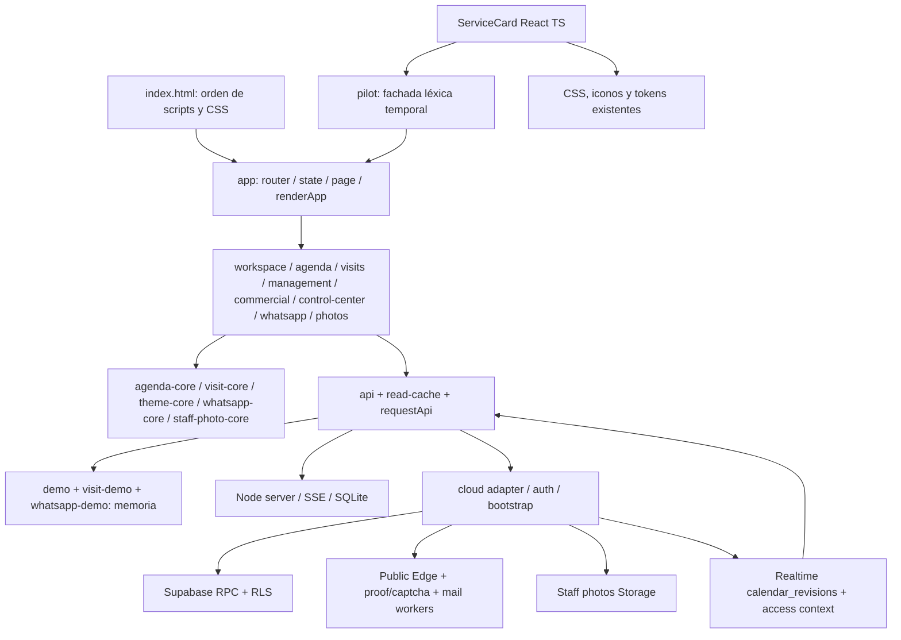

# Decisión técnica y mapa de dependencias

## Stack adoptado

Dependencias exactas y lockfile propios en frontend/react. React y React DOM 19.3.1; TypeScript 7.0.2; Vite 8.3.5; tipos de React/DOM 19.3.0 y Node 26.6.5. Instalación real del registro, sin depender del node_modules de otras versiones. Node local 22.18.0; build validado. El backend continúa con engines >=22.13 y sus dependencias originales.

- React/DOM: árbol declarativo, composición y ciclo de vida; coste runtime medido en RESULTADOS. No SSR, servidor de componentes ni compiler adicional. Mantenimiento oficial; revisar actualizaciones en cambios separados y pinnear versiones.
- TypeScript: sólo código nuevo, strict/noEmit, sin migración automática de JS. Contratos locales Service, SessionScope, ApiPort y IAtryPort. Tipos no validan respuestas en ejecución: futura fachada debe validar/mapejar datos y errores de contrato. Tipos Node son de herramientas, no promesa de APIs Node26 en runtime.
- Vite: dev server y bundle local, reutiliza CSS/activos por middleware de demo. No cambia el build de producción. No plugin React/Babel: JSX mediante la herramienta y tsconfig; HMR básico, sin Fast Refresh por ahora. Herramientas/types son coste de desarrollo y no se envían al usuario.
- React Router: evaluado y diferido. El primer componente no controla navegación; introducir otro router ahora competiría con hashchange y tokens públicos. Cuando React posea una ruta completa, usar un único hash router compatible y conservar URLs. No inventar navegación paralela por pantalla.
- Consultas/caché: sin nueva librería en etapa1. Reutilizar semántica de read-cache tras fachada tipada y pruebas de invalidación/tenancy. TanStack Query se reconsidera si varias pantallas React necesitan estados compartidos, cancelación y reintentos; medir bytes y reemplazar un solo dueño de caché, nunca dos caches incoherentes.
- CSS: reutilización exacta; sin biblioteca visual, reset, Tailwind, estado global externo ni librería de animación.

Documentación oficial consultada: [React versions](https://react.dev/versions), [Vite guide](https://vite.dev/guide/). Las versiones efectivamente usadas figuran en package-lock; no se depende de un tag latest al reproducir `npm ci`.

## Arquitectura destino incremental

`app/`: composición, sesión y negocio, router único, providers mínimos, límites de error. `features/{booking,agenda,services,staff,customers,communications,settings,admin}`: pantallas, queries y formularios. `domain/`: fachadas de motores puros con fixtures de equivalencia. `infrastructure/`: ApiPort, cloud/HTTP/demo, cache, realtime. `ui/`: tokens y componentes con DOM aprobado. `extensions/iatry`: puerto contextual y slots de presencia/guía/insight/motion.

Estado de servidor en adaptador/caché; sesión/negocio como contexto explícito; formularios y diálogos locales; selección de rutas serializable en hash. Al cambiar sesión/negocio cancelar respuestas obsoletas, invalidar caché y cerrar canales. Un formulario debe sobrevivir rerenders sin perder idempotencia, errores ni foco. Autorización siempre backend.

## Piloto y deuda temporal explícita

ServiceCard es JSX nativo; no renderiza HTML heredado. Mantiene clases, estructura, contenido, iconos y data-action. `pilot.tsx` es la única costura con globals; observa reemplazos de #root, desmonta raíces desconectadas y evita montar dos veces. Los clics burbujean hacia handlers existentes: creación, edición, ocultación y diálogos continúan legacy. El shell, carga de datos y formularios NO son React. No introducir esta costura como API de arquitectura definitiva: sustituirla por fachada y dueño de ruta al migrar una pantalla entera. Bundle library local para validar; no se incorpora al despliegue original.

IAtry: sólo interfaces de contexto/puerto; ninguna importación de la rama experimental. Futura integración adaptará motor puro/knowledge/memory al scope de sesión/negocio y limpiará estado al salir. Presencia/guía/insights/motion serán componentes opcionales, con reduced-motion, overlays y stacking revisados. Mantener animaciones V1.2 como referencia; no se han reimplementado ni descartado.
