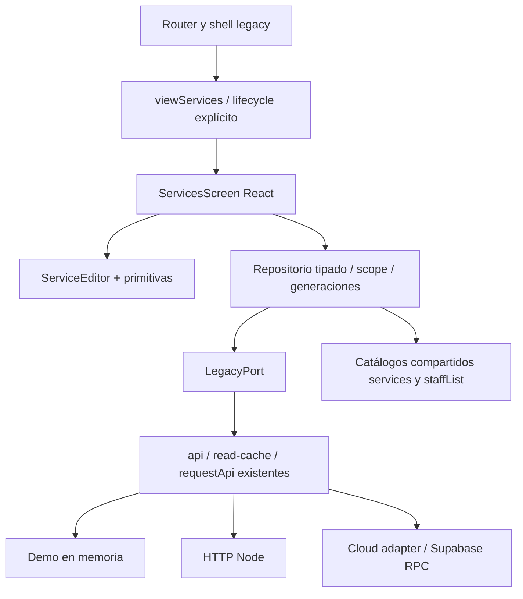

# ATRY Turnos - React / Etapa 2

Se migró **la pantalla Servicios**, incluyendo carga, lista, alta, edición, activación, desactivación, formulario, confirmaciones, errores, borradores y actualización de datos compartidos. El frontend experimental sigue aislado y local. No se convirtió otra pantalla.

## Revisión de la etapa1

La isla anterior generaba primero las tarjetas legacy y luego las reemplazaba con React mediante MutationObserver. Sus botones delegaban a onClick y onSubmit existentes; los diálogos reconstruían el shell. Eso era una prueba visual, no una pantalla funcional migrada. Se eliminó el observador y ese doble render. Un respaldo local conserva las fuentes de etapa1 en ../respaldo-react-etapa1/.

Ahora viewServices cede la ruta a la extensión antes de ejecutar cualquier plantilla legacy. El shell crea un host vacío una sola vez; React renderiza la pantalla completa. Al abrir/guardar un diálogo, el shell y el resto de tarjetas no se reconstruyen. Las teclas del diálogo tienen un solo manejador propietario; los eventos React no usan data-form/data-action heredados ni serviceModal/onSubmit/onClick para Servicios. Se conserva la implementación original como fallback cuando react=1 no está activo.

## Componentes y capas

| Archivo / componente | Responsabilidad |
|---|---|
| ui/primitives: Button | Variantes y tamaños con clases aprobadas; atributos nativos tipados |
| TextField / SelectField | Label asociado al control, props nativas; sin API de formulario compleja |
| Card / Badge | DOM/clases de tarjetas e indicadores actuales |
| Feedback | Estados accesibles de carga/error y reintento |
| Modal | Portal, foco inicial/restauración, Escape, Tab/Shift+Tab y cierre por fondo |
| Confirmation | dialog nativo, confirmación, cancelación y devolución de foco |
| Icon | Registro SVG estático aprobado; nunca SVG tomado de respuestas de API |
| ServiceCard | Presentación de servicio y callbacks React |
| ServiceEditor | Estado local del borrador; no consulta ni accede a globals |
| ServicesScreen | Estado de catálogo/errores/operación/editor; coordina flujo y repositorio |
| services/form | Valores iniciales y conversión a payload numérico; restricciones HTML originales |
| services/repository | Contrato runtime de respuestas, lecturas compartidas en vuelo, escritura única y generaciones |
| services/contracts | Scope, ServicePayload, Catalog, Staff, LegacyPort y Extension |
| pilot.tsx | Dueño único de raíz, montaje/desmontaje explícito y cambios de scope |
| web/react-services-bridge.js | Fachada de globals: API existente, scope, publicación de catálogo y shell |

SelectField queda disponible como primitiva; Servicios utiliza su lista de profesionales con checkboxes igual que antes. No se añadió una librería de formularios, estado, consultas, Router, iconos o estilos. Las versiones y lockfile React se conservan.

## Capacidades conservadas

- Consultar servicios y profesionales en paralelo; errores de lectura y reintento.
- Crear y editar nombre, descripción, precio UYU, duración, seña estimada, preparación y limpieza.
- Asignar/desasignar profesionales. Al crear, selecciona todos como el formulario original; al editar, lee service_ids del catálogo de profesionales. Incluye el mismo conjunto original, sin inventar filtros por plan.
- Ocultar con confirmación; publicar sin confirmación adicional. Las reservas existentes permanecen.
- Restricciones originales de formulario: nombre mínimo2, precio mínimo0, duración5-720, seña0-100 y buffers0-180. Seña/buffers vacíos se convierten a0 como antes. No se añadieron topes de precio ni se truncó descripción en frontend: Node/RPC conservan sus límites propios.
- Owner/manager con acceso habilitado; staff no gestiona Servicios. No se inventó un cupo de cantidad de servicios: los cupos de profesionales y capacidades siguen en backend/entitlements existentes.
- Un guardado en curso bloquea segundo submit y otras escrituras. Los errores de servidor mantienen campos y selección. Confirmación al cerrar o navegar con borrador; cancelar restaura URL y formulario. Refresh/realtime mantiene la raíz y el borrador.
- Cambiar sesión/negocio/rol/acceso invalida scope. El repositorio se invalida al desmontar y rechaza generaciones anteriores, aunque vuelva la misma cuenta. Publicación en state.services/staffList sólo en scope vigente. No se persisten borradores ni datos privados en storage.
- La regla de duración con reservas futuras permanece en backend y se probó con HTTP409 real. El servidor también rechazó403 por negocio ajeno y suscripción vencida, aunque el frontend declarase owner.

## Convivencia y dependencias restantes

Todavía son legacy: router hash y shell/sidebar, autenticación, negocio/capacidades, transporte HTTP/cloud, caché/prefetch/realtime, tokens de apariencia/iconos y notificaciones toast. Las reglas de negocio, permisos y suscripciones siguen en Node/RPC/RLS. Las demás pantallas y sus formularios no se migraron. Esta dependencia compartida es deliberada; no se declara una SPA completa React.

page() desmonta la raíz antes de reemplazar el DOM; la navegación y cambio de negocio consultan beforeLeave. Cierre de sesión desmonta inmediatamente. Una restauración de bfcache recarga la entrada demo en vez de dejar una raíz eliminada. No hay observación continua de DOM ni callbacks de negocio en componentes visuales.

Servicios reutiliza read-cache con namespace y rutas existentes, invalidación antes/después de escribir y fresh al refrescar. Su repositorio sólo comparte promesas en vuelo, sin segunda caché persistente. Cloud adapter sigue compartiendo catálogo servicios/staff en un RPC. No se reimplementó Supabase en React.

## Seguridad, demos y service worker

El servidor local exige demo=1 y sólo permite archivos estáticos bajo /legacy. /api devuelve403; CSP bloquea conexiones externas, formularios nativos y workers. No se cargan config/SDK cloud ni credenciales. La prueba HTTP real usa interceptación controlada del runner y SQLite :memory: en loopback efímero; esa conexión no se entrega al frontend ni queda configurada en él.

Para evitar mezcla de recursos en el worktree, index y allowlist SW usan app.js?v55 y cachev106. El SW original se prueba con la suite; la entrada experimental no lo registra y bloquea su descarga. El puente se inyecta sólo con react=1; no se agregó a index.html ni a la allowlist del SW. No se habilitó publicación de React, ni se editó SQL, servidor o adaptador cloud.

## Resultados y siguiente pantalla

Ver [RESULTADOS.md](RESULTADOS.md), evidencias PNG/JSON y PDF con imágenes incrustadas. Los tiempos y memoria son mediciones locales, no de Supabase. Se detallan diferencias de rasterización de capturas, límites de interpretación y riesgos pendientes.

Recomiendo **Clientes** para la siguiente pantalla: comparte tarjetas, búsqueda y ficha/modal, permite consolidar cancelación de lecturas y manejo de borradores antes de entrar a Agenda. Mantener inicialmente historial, WhatsApp manual y acceso a crear reserva/turno fijo como integraciones explícitas; no declararla migrada hasta probar esos flujos. Agenda y reservas combinadas quedan para después por concurrencia, recursos, horarios y operaciones atómicas.

Esta recomendación no se implementó. Nos detenemos en Servicios, sin publicación ni merge, para revisar la entrega.
